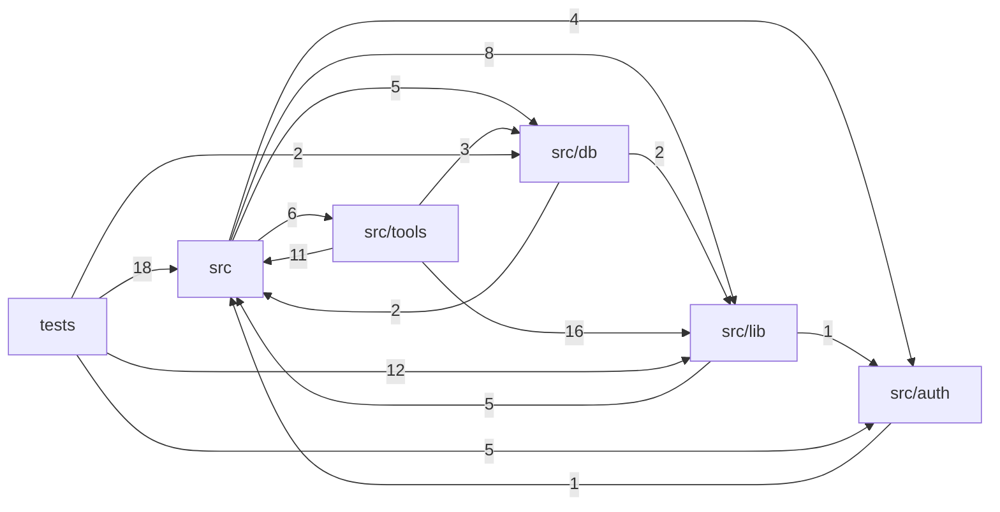

# Mapa del proyecto — mcp-suite-mx

> Generado por GEMELO (mcp-suite-mx) el 2026-10-11T11:16:34.700Z. Raíz: `/home/user/mcp-suite-mx`.

## Resumen

| Indicador | Valor |
|---|---|
| Archivos de código | 47 |
| Líneas | 8278 |
| Rutas HTTP detectadas | 12 |
| Archivos de prueba | 10 |
| Entradas | 4 |
| Desconectados | 0 |
| Funciones duplicadas | 0 |

## Módulos

| Módulo | Archivos | Líneas | Rutas | Exportados |
|---|---:|---:|---:|---:|
| `src/lib` | 13 | 2774 | 0 | 115 |
| `src/tools` | 6 | 1844 | 0 | 6 |
| `tests` | 11 | 1563 | 3 | 2 |
| `src` | 10 | 1160 | 9 | 22 |
| `src/db` | 3 | 569 | 0 | 20 |
| `src/auth` | 2 | 216 | 0 | 13 |
| `scripts` | 2 | 152 | 0 | 0 |

## Dependencias entre módulos

## Rutas HTTP

| Método | Ruta | Archivo | Línea |
|---|---|---|---:|
| ANY | `/mcp` | `src/http.ts` | 143 |
| ANY | `/health` | `src/http.ts` | 184 |
| ANY | `/metrics` | `src/http.ts` | 194 |
| ANY | `/api/config` | `src/http.ts` | 199 |
| ANY | `/api/catalogo` | `src/http.ts` | 213 |
| ANY | `/api/herramientas` | `src/http.ts` | 222 |
| ANY | `/` | `src/http.ts` | 228 |
| ANY | `/panel` | `src/http.ts` | 228 |
| ANY | `/api/auditoria` | `src/http.ts` | 259 |
| GET | `/api/pedidos` | `tests/taller.test.ts` | 39 |
| GET | `/api/reportes` | `tests/taller.test.ts` | 40 |
| POST | `/api/reportes/exportar` | `tests/taller.test.ts` | 40 |

## Servicios y dependencias externas

| Paquete | Uso | Archivos |
|---|---|---:|
| `vitest` | paquete externo | 10 |
| `zod` | validación de datos | 8 |
| `@modelcontextprotocol/sdk` | SDK de MCP | 6 |
| `better-sqlite3` | SQLite local | 1 |
